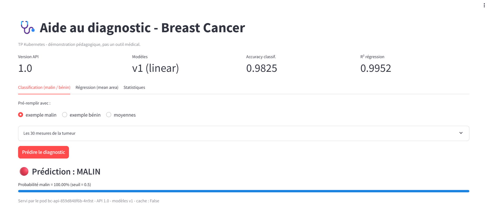
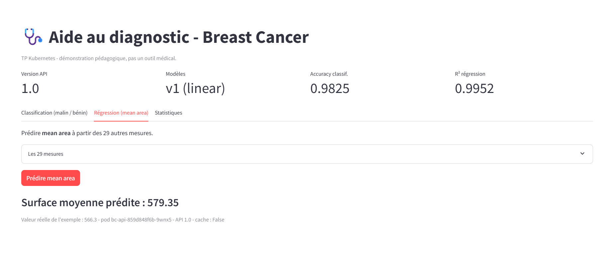
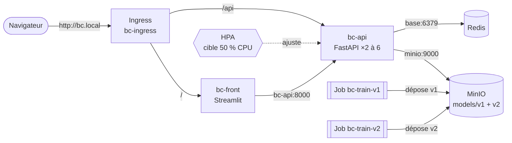
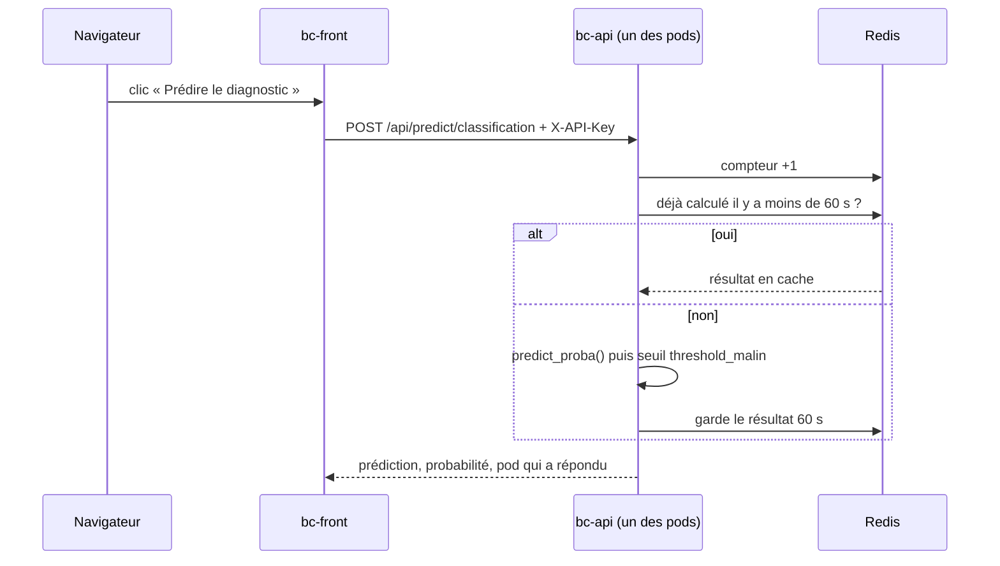

<p align="center">
  
</p>

<p align="center">
  
  
  
  
  
  
  
  
</p>

<p align="center"><i>TP Kubernetes du module Cloud & IA — Pr. Mohammed AMEKSA — 2026/2027</i></p>

<p align="center">
  <b>Partie A</b> : déployer la stack &nbsp;·&nbsp; <b>Partie B</b> : l'exploiter (sondes, config à chaud, autoscaling, mise à jour et rollback)
</p>

---

## Le contexte

Entraîner un modèle dans un notebook, c'est la partie facile. Le mettre à disposition, c'est une autre histoire : il faut un endroit où ranger les modèles, un service qui les charge et répond aux requêtes, une interface pour les utilisateurs, et que tout ça continue de tourner quand un morceau tombe.

Le cas d'usage est le jeu de données **Breast Cancer Wisconsin** : 569 tumeurs, 30 mesures chacune. Deux modèles en sortent :

- une **classification** : la tumeur est-elle maligne ou bénigne ?
- une **régression** : prédire sa surface moyenne (`mean area`) à partir des 29 autres mesures.

Avec seulement `docker run`, on se heurte vite à des murs :

- 💥 un conteneur qui plante reste par terre, personne ne le relance ;
- 🔑 les mots de passe et les adresses finissent écrits en dur dans les images ;
- 🧭 les services se cherchent par IP, et l'IP change à chaque redémarrage ;
- 📈 un pic de trafic, et il faut ajouter des conteneurs à la main ;
- 🔄 une mise à jour, c'est une coupure, et un retour en arrière, c'est la panique.

Le code applicatif et les Dockerfiles étaient fournis. **Tout le travail est dans `k8s/`** : douze manifestes, écrits à la main, étape par étape.

## Ce que Kubernetes règle ici

| Principe | Ce que ça change concrètement | Partie |
|---|---|---|
| 🧩 **Configuration externalisée** | Aucune adresse ni mot de passe dans les images : tout vient de 2 ConfigMaps et 2 Secrets | A |
| 🧭 **Découverte par nom** | Le front appelle `bc-api:8000`, l'API appelle `minio:9000` et `base:6379`. Pas une seule IP dans le code | A |
| 🚪 **Un seul point d'entrée** | `http://bc.local` : l'Ingress envoie `/api` vers l'API, et tout le reste vers l'interface | A |
| 🏁 **Tâche ponctuelle** | L'entraînement est un Job : il tourne, dépose les modèles, s'arrête | A |
| 🩺 **Auto-réparation** | Un pod bloqué est redémarré en 20 à 30 s par sa liveness | B |
| 🚦 **Mise à l'écart** | Quand Redis tombe, l'API sort du trafic sans redémarrer, puis revient seule | B |
| 🎛️ **Configuration à chaud** | Le seuil de décision change en une minute, sans recréer un seul pod | B |
| 📈 **Autoscaling** | De 3 à 6 pods en moins de deux minutes quand le CPU s'emballe | B |
| 🔄 **Mise à jour sans coupure** | Passage en v2 pod par pod, puis retour en v1 en une commande | B |

## La démo, en vrai

<table>
<tr>
<td width="50%"></td>
<td width="50%"></td>
</tr>
<tr>
<td><b>Classification</b> — l'exemple malin est classé <b>MALIN</b>, probabilité 100 %, seuil 0,5. Servi par le pod <code>…-4n9st</code>.</td>
<td><b>Régression</b> — surface prédite <b>579,35</b> pour une valeur réelle de 566,3. Servi par le pod <code>…-9wnx5</code>.</td>
</tr>
</table>

Deux clics, deux pods différents : c'est le Service `bc-api` qui répartit les requêtes.

## Comment ça marche, en clair

Imaginez un restaurant.

- Le **Job** est le cuisinier : il prépare les plats une seule fois (il entraîne les modèles), les range, puis rentre chez lui.
- **MinIO** est la chambre froide où les plats attendent.
- Les **pods de l'API** sont les serveurs : ils vont chercher les plats et les servent aux clients.
- **Redis** est le carnet de commandes : il compte, et se souvient de ce qu'on vient de servir.
- **Streamlit** est la salle. L'**Ingress** est la porte d'entrée, et c'est la seule.
- Les **sondes** sont le chef de salle : il vérifie régulièrement que chaque serveur répond, renvoie chez lui celui qui est bloqué, et met en pause celui qui n'a pas encore ses plats.
- Le **HPA** appelle des renforts quand la salle se remplit, et les renvoie quand elle se vide.



### Le trajet d'une prédiction



---

## Partie A — Déployer la stack

Chaque fichier a été écrit avec la méthode **GMA** : **G**énérer le squelette (`kubectl create … --dry-run=client -o yaml`), le **M**odifier, puis l'**A**ppliquer (`kubectl apply -f`). Le fichier reste la référence.

| # | Fichier | Objets | Ce que l'étape montre |
|---|---|---|---|
| 00 | `00-pod-api.yaml` | Pod | Un pod seul est `Running`, mais incapable de prédire, et il ne revient pas si on le supprime |
| 01 | `01-secrets.yaml` | 2 Secrets | Mots de passe MinIO et clé d'API, seulement encodés en base64 (non versionné) |
| 02 | `02-configmaps.yaml` | 2 ConfigMaps | `ml-config` en variables, `model-config` en **fichier monté** |
| 03 | `03-minio.yaml` | Deployment + Service | Renommage des clés du Secret, volume `emptyDir`, stratégie `Recreate` |
| 04 | `04-train-job-v1.yaml` | Job | `backoffLimit`, `restartPolicy: Never`, requests/limits |
| 05 | `05-redis.yaml` | Deployment + Service `base` | Un Service peut porter un autre nom que son Deployment : c'est le *selector* qui fait le lien |
| 06 | `06-api.yaml` | Deployment + Service | `envFrom`, `secretKeyRef`, ConfigMap monté sans `subPath` |
| 07 | `07-front.yaml` | Deployment + Service | `configMapKeyRef`, port 80 → 8501 |
| 08 | `08-ingress.yaml` | Ingress | Routage par préfixe, timeouts pour le websocket de Streamlit |

Au démarrage, l'API cherche ses modèles dans MinIO. S'ils ne sont pas encore là, elle **réessaie toutes les 5 secondes** au lieu de planter. Pendant le TP, les logs l'ont montrée patienter (`NoSuchBucket`), puis afficher `modèles v1 chargés` dès que le Job a fini, sans aucune intervention.

---

## Partie B — Exploiter la stack

### 🩺 Des sondes sur chaque composant

| Composant | startup | liveness | readiness | requests → limits |
|---|---|---|---|---|
| API | `/health`, 2 s × 30 | `/health`, 10 s × 3 | `/ready`, 5 s × 2 | 100m/256Mi → 500m/512Mi |
| Front | `/_stcore/health`, 5 s × 24 | `/_stcore/health` | `/_stcore/health` | 100m/256Mi → 1/768Mi |
| MinIO | — | `/minio/health/live` | `/minio/health/ready` | 100m/256Mi → 500m/512Mi |
| Redis | — | `tcpSocket` 6379 | `exec redis-cli ping` | 50m/64Mi → 250m/128Mi |

Toute la partie B repose sur une distinction simple :

- **liveness** (`/health`) : « le programme répond-il ? » Si non, **redémarrage** ;
- **readiness** (`/ready`) : « modèles chargés **et** Redis joignable ? » Si non, le pod est **retiré du trafic**, mais pas redémarré.

**Expérience A — Redis arrêté.** Les 3 pods de l'API passent en `0/1` en une dizaine de secondes, et `RESTARTS` reste à 0. Le Service se vide, et l'Ingress répond `503`. Redis revient : les pods repassent en `1/1` tout seuls.

<p align="center"></p>

**Expérience B — API bloquée** (`/api/admin/break-health`). La liveness échoue 3 fois de suite, et Kubernetes redémarre le conteneur **20 s après le premier échec**, soit 2 intervalles de 10 s.

<p align="center"></p>

**Expérience C — ressources.** Au repos, l'API utilise environ 5m de CPU pour 100m réservés, et environ 120Mi de mémoire. Elle est en QoS **Burstable** : un minimum garanti, avec de la marge jusqu'à sa limite.

### 🎛️ Changer la configuration à chaud

Le seuil `threshold_malin` vient d'un ConfigMap **monté en fichier**. Je l'ai passé de 0,5 à 0,05 :

- le fichier a changé dans les pods **en un peu plus d'une minute**, sans en recréer aucun ;
- l'exemple bénin (probabilité malin de 8,54 %) a basculé de **BÉNIN** à **MALIN**.

<p align="center"></p>

`LOG_LEVEL`, lui, est une **variable d'environnement** : il n'a changé qu'après un `kubectl rollout restart`. Une variable est lue une seule fois, au démarrage du processus.

> Côté médical, un seuil bas réduit les faux négatifs (un cancer raté), au prix de nombreux faux positifs (des examens en trop). Le bon seuil se choisit avec les médecins, pas dans un YAML.

### 📈 Autoscaling

```powershell
kubectl autoscale deployment bc-api --cpu-percent=50 --min=2 --max=6
```

Sous la charge de deux générateurs `busybox`, qui appellent `/api/info` en boucle :

| Moment | CPU moyen | Pods |
|---|---|---|
| au repos | 3 % | 3 |
| 1ʳᵉ charge | 64 % | 3 → **4** |
| 2ᵉ charge | 196 % | 4 → **6** (le maximum) |

<p align="center"></p>

Le pourcentage se calcule par rapport à la *request* CPU : sans `resources`, pas d'autoscaling.

### 🔄 Mise à jour v2, puis retour arrière

Le Job `bc-train-v2` entraîne des RandomForest (`ALGO=forest`) dans `models/v2/`. La v2 est déployée avec `12-api-v2.yaml` (`bc-api:2.0`, `MODEL_VERSION=v2`) :

```yaml
strategy:
  type: RollingUpdate
  rollingUpdate:
    maxSurge: 1          # un pod v2 en plus avant d'en retirer un v1
    maxUnavailable: 0    # jamais moins de pods prêts que demandé
revisionHistoryLimit: 5
```

Les pods sont remplacés un par un, et la boucle de surveillance n'a affiché aucune erreur. Puis la comparaison :

| Tâche | Métrique | v1 (linear) | v2 (forest) |
|---|---|---|---|
| Classification | Accuracy | **0,9825** | 0,9561 |
| | F1 | **0,9861** | 0,9655 |
| Régression | R² | 0,9952 | **0,9981** |
| | MAE | 15,37 | **7,69** |

La v2 est meilleure en régression, mais **moins bonne en classification** : 5 erreurs sur 114 tumeurs de test, contre 2 en v1. Pour un outil d'aide au diagnostic, c'est rédhibitoire. Retour arrière :

```powershell
kubectl rollout undo deployment/bc-api
```

<p align="center"></p>

Le rollback ne crée pas de nouveau ReplicaSet : il **réutilise** celui de la v1, qui reprend ses pods. Celui de la v2 reste vide mais conservé, prêt à resservir. `MODEL_VERSION` est écrit dans le template du Deployment, et non dans le ConfigMap : l'image et les modèles reviennent en arrière **ensemble**. Dans le ConfigMap, le rollback aurait donné un mélange incohérent, l'image 1.0 avec les modèles v2.

| # | Nouveau fichier | Rôle |
|---|---|---|
| 09 | `09-hpa.yaml` | Autoscaler de 2 à 6 pods, cible 50 % de CPU |
| 11 | `11-train-job-v2.yaml` | Entraînement des RandomForest |
| 12 | `12-api-v2.yaml` | Le Deployment de l'API en v2 |

Les fichiers `02`, `03`, `05`, `06` et `07` ont aussi été enrichis : sondes, ressources, stratégie de mise à jour et `change-cause`.

---

## Ce qu'on a appris en chemin

| 🧩 Problème rencontré | 🔧 Ce qu'on a fait |
|---|---|
| `docker build` : `path "app/trainer" not found` | L'archive s'était extraite dans un sous-dossier du même nom. On travaille depuis le dossier qui contient `app/` |
| `pip install` coupé en plein build (`Read timed out`) | Changement de réseau. Docker garde les couches déjà construites : `bc-api:2.0` s'est construite en 2 s grâce au cache |
| Pods en `ImagePullBackOff` | Minikube a son propre stockage d'images : `minikube image load`, et `imagePullPolicy: IfNotPresent` |
| L'API répondait `NoSuchBucket` | Le Job n'avait jamais été appliqué. Une fois lancé, l'API a chargé les modèles toute seule |
| `Connection refused` sur `base:6379` | `selector: app: base` généré par kubectl. `kubectl get endpoints base` affichait `<none>`. Corrigé en `app: redis` |
| `ERR_NAME_NOT_RESOLVED` sur `bc.local` | Fichier hosts pas réellement modifié. Corrigé depuis un PowerShell administrateur |
| Modifier MinIO effaçait les modèles | `emptyDir` vidé à chaque recréation du pod. MinIO appliqué en premier, puis Job v1 relancé avant le reste |
| Ligne illisible dans `02-configmaps.yaml` (`\uFEFF\x74…`) | PowerShell avait ajouté un BOM et des fins de ligne Windows. Fichier réécrit en YAML propre (`model-config.yaml: \|`) |
| `curl` : `Could not connect to server` | `minikube tunnel` arrêté. Relancé dans un PowerShell administrateur |
| `CHANGE-CAUSE` resté à `<none>` | L'annotation n'était pas encore recopiée sur la révision. Un second `apply` a suffi |
| La mise à jour v2 ne démarrait pas | Le terminal était dans le dossier parent. Avec `kubectl get rs`, on voit tout de suite s'il y a un nouveau ReplicaSet |

## Démarrage rapide

**Prérequis** : Docker Desktop, Minikube et kubectl. Testé sous Windows 11, Minikube v1.39, driver docker.

```powershell
# 1. Cluster
minikube start
minikube addons enable ingress
minikube addons enable metrics-server

# 2. Images
.\scripts\build-images.ps1

# 3. Secrets (non versionnés)
kubectl create secret generic minio-secret `
  --from-literal=MINIO_ACCESS_KEY=<utilisateur> `
  --from-literal=MINIO_SECRET_KEY=<mot-de-passe>
kubectl create secret generic api-secret --from-literal=API_KEY=<cle-api>

# 4. Stack (partie A + sondes de la partie B)
kubectl apply -f k8s\02-configmaps.yaml
kubectl apply -f k8s\03-minio.yaml
kubectl apply -f k8s\04-train-job-v1.yaml
kubectl apply -f k8s\05-redis.yaml
kubectl apply -f k8s\06-api.yaml
kubectl apply -f k8s\07-front.yaml
kubectl apply -f k8s\08-ingress.yaml
kubectl apply -f k8s\09-hpa.yaml
```

Ensuite, dans un PowerShell **administrateur** à laisser ouvert : `minikube tunnel`. Ajoute `127.0.0.1 bc.local` au fichier `C:\Windows\System32\drivers\etc\hosts`, puis ouvre 👉 **http://bc.local**.

Pour la v2 :

```powershell
kubectl apply -f k8s\11-train-job-v2.yaml      # modèles v2 dans MinIO
kubectl apply -f k8s\12-api-v2.yaml            # mise à jour progressive
kubectl rollout undo deployment/bc-api         # retour en v1
```

<details>
<summary>⚙️ Configuration</summary>

<br>

| Variable | Source | Valeur | Lue par |
|---|---|---|---|
| `MINIO_ENDPOINT` | ml-config | `minio:9000` | trainer, api |
| `MINIO_BUCKET` | ml-config | `models` | trainer, api |
| `REDIS_HOST` / `REDIS_PORT` | ml-config | `base` / `"6379"` | api |
| `CACHE_TTL` | ml-config | `"60"` | api |
| `LOG_LEVEL` | ml-config | `INFO` | api (lue au démarrage seulement) |
| `APP_TITLE` | ml-config | titre de la page | front |
| `MINIO_ACCESS_KEY` / `MINIO_SECRET_KEY` | minio-secret | — | trainer, api ; MinIO les lit sous `MINIO_ROOT_USER` / `MINIO_ROOT_PASSWORD` |
| `API_KEY` | api-secret | — | api, front |
| `MODEL_VERSION` | template du Deployment | `v1` / `v2` | trainer, api |
| `ALGO` | Job | `linear` / `forest` | trainer |
| `APP_VERSION` | gravée dans l'image | `1.0` / `2.0` | api |
| `threshold_malin` | model-config, fichier monté | `0.5` | api (relu à chaud) |

</details>

<details>
<summary>🔌 Routes de l'API</summary>

<br>

| Méthode | Route | Clé | Rôle |
|---|---|---|---|
| GET | `/health` | — | Le processus répond (liveness) |
| GET | `/ready` | — | Modèles chargés **et** Redis joignable (readiness) |
| GET | `/api/info` | — | Versions, métriques, exemples |
| GET | `/api/stats` | — | Compteurs et pod qui a répondu |
| POST | `/api/predict/classification` | ✔ | Malin ou bénin |
| POST | `/api/predict/regression` | ✔ | `mean area` |
| POST | `/api/admin/break-health` | ✔ | Simule une panne de `/health` |

</details>

<details>
<summary>🩺 Commandes de diagnostic utiles</summary>

<br>

```powershell
kubectl get deploy,svc,ingress,jobs,cm,secret,hpa
kubectl get endpoints bc-api              # quels pods reçoivent du trafic
kubectl describe pod <pod>                # section Events : sondes, redémarrages
kubectl top pods                          # consommation réelle
kubectl get rs -l app=bc-api              # un ReplicaSet par version
kubectl rollout history deployment/bc-api
```

</details>

<details>
<summary>📁 Organisation du projet</summary>

<br>

```
.
├── app/
│   ├── api/          FastAPI : modèles, prédictions, cache Redis, /health et /ready
│   ├── front/        Streamlit
│   └── trainer/      scikit-learn : entraînement et dépôt dans MinIO
├── k8s/              00 à 08 (partie A), 09, 11, 12 (partie B) ; 01-secrets.yaml exclu
├── scripts/
│   ├── build-images.ps1
│   └── test-api.ps1
├── docs/             bannière et captures
└── model-config.yaml
```

</details>

## Limites et pistes

- 💾 **MinIO stocke toujours sur un `emptyDir`.** Chaque modification de son Deployment efface les modèles, et oblige à relancer les Jobs. Un PersistentVolumeClaim est la prochaine chose à ajouter.
- 🔀 **v1 ou v2, mais pas les deux.** La meilleure combinaison serait la classification v1 avec la régression v2. Il faudrait une version par modèle (`CLASSIFIER_VERSION`, `REGRESSOR_VERSION`) ou une v3 combinée.
- 🔐 **Un Secret n'est que du base64.** Il est exclu de Git, mais reste lisible par quiconque a accès au cluster. En production : chiffrement d'etcd, ou Sealed Secrets.
- ⚖️ **`replicas: 3` dans le fichier, et un HPA à côté.** Chaque `apply` remet 3 pods, avant que le HPA ne corrige. Avec un HPA, on retirerait `replicas` du Deployment.
- 🏷️ **MinIO en `:latest`**, et un seul nœud : suffisant pour apprendre, pas pour la production.


<p align="center"><sub>Projet pédagogique, pas un outil médical. · <a href="https://github.com/ssabiridrissi-rgb">ssabiridrissi-rgb</a></sub></p>
